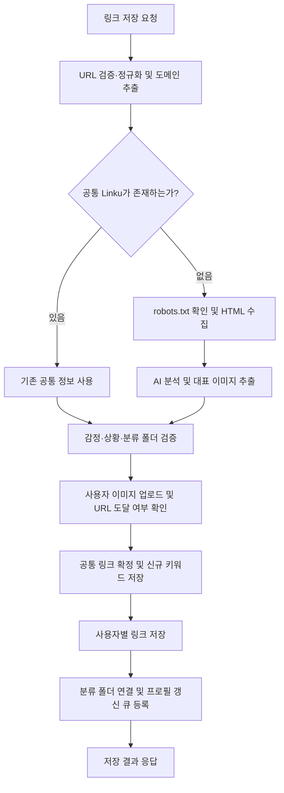

## 링크 생성 
링크 생성은 사용자가 입력한 URL을 저장하고, 자동으로 폴더를 분류해주는 기능입니다.
URL에서 데이터를 크롤링하고, AI를 사용하여 링크를 적절한 카테고리의 폴더로 분류합니다.

### 데이터 저장
- linku 테이블은 어떤 특정 URL에 대해 AI가 분석한 정보를 저장합니다.
- users_linku 테이블은 URL에 대해 사용자가 입력한 정보를 저장합니다.

### 데이터 분석 방법 
- URL로부터 웹페이지 정보를 수집하고 AI로 분류·키워드·제목을 생성합니다. 
- 새로운 URL이라면 데이터 크롤링 + AI분석을 수행합니다. 이미 저장된 URL이면 공통 링크 정보를 재사용합니다.
- 신규 링크는 해당 사용자가 처음 저장한 링크가 아니라, 정규화한 URL에 해당하는 공통 `Linku`가 아직 없는 링크를 뜻한다.
- 데이터 크롤링은 robots.txt를 기준으로 수행합니다. 

| 데이터 | 의미 | 주요 정보                                       |
| --- | --- |---------------------------------------------|
| `Linku` | URL을 기준으로 공유하는 공통 링크 | URL(ID), 제목, 카테고리, 도메인, 대표 이미지, AI감정, AI상황  |
| `Keyword` | 키워드 이름 | 이름                                          |
| `UsersLinku` | 사용자가 저장한 링크 | 사용자(FID), URL(FID), 제목, 메모, 업로드 이미지, 감정, 상황 |
| `LinkuKeyword` | 공통 링크와 키워드의 연결 | 공통 링크, 키워드                                  |
| `LinkuFolder` | 사용자 링크와 폴더의 연결 | 분류 폴더, 사용자 링크                               |

## 요청

- API: `POST /api/v1/linku`
- 인증: 로그인 사용자의 인증 정보에서 사용자 ID를 가져온다.
- 요청 형식: `multipart/form-data`

| 필드 | 필수 여부 | 설명 |
| --- | --- | --- |
| `linku` | 필수 | 저장할 URL |
| `memo` | 선택 | 사용자 메모 |
| `title` | 선택 | 사용자가 지정한 제목 |
| `emotionId` | 선택 | 사용자가 지정한 감정 ID |
| `situationId` | 선택 | 사용자가 지정한 상황 ID |
| `image` | 선택 | 사용자가 첨부한 이미지 파일 |

컨트롤러는 URL·메모·제목·감정·상황을 Converter를 통해 `LinkuCreateDTO`로 변환한다. 이미지 파일과 사용자 ID는 별도로 서비스에 전달한다.

## 전체 처리 순서

### 1. URL 검증 및 정규화

`LinkuCreateService.createLinku()`에서 URL의 형식을 검증하고 저장·조회에 사용할 URL로 정규화한다. 이후 도메인 정보와 도메인 조회 후보를 추출한다.

정규화한 URL로 공통 `Linku`를 조회하여 신규 링크인지 판단한다.

### 2. 신규 링크의 웹페이지 정보 수집

신규 링크는 `prepareNewLinkuAiData()`에서 정보를 준비한다.

1. `RobotsTxtChecker`로 해당 URL의 크롤링 허용 여부를 확인한다.
2. 허용된 경우 `SafeUrlFetcher`로 HTML을 가져온다.
3. 외부 요청 시 `SsrfGuard`로 스킴·포트·목적지 IP를 검증한다. 리다이렉트 목적지도 다시 검증한다.
4. 가져온 HTML을 AI 분석과 대표 이미지 추출에 사용한다.

HTML을 가져오지 못하거나 크롤링이 허용되지 않으면 AI·이미지 추출을 생략하고 대체 제목을 준비한다. 이후 기본 분류값을 이용해 저장을 진행할 수 있다.

### 3. AI 분석과 대표 이미지 추출

**AI 분석**은 다음 정보를 바탕으로 공통 링크의 메타데이터를 만든다.

- 도메인과 페이지 제목
- 페이지에서 추출한 본문 일부
- DB에 등록된 카테고리·상황·감정 후보 목록

`GeminiLinkuService`는 분석 결과로 카테고리 ID, 키워드, 제목, 상황 ID, 감정 ID를 받는다. 제목은 `og:title` 또는 HTML 제목에서 가져오고, 본문은 도메인별 추출 전략을 사용한다. 네이버 블로그처럼 iframe 구조인 페이지는 내부 페이지에서 본문을 추출할 수 있다.

**대표 이미지 추출**은 `ImageFetchService`에서 비동기로 시작한다. `LinkToImageService`가 메타 정보와 본문에서 이미지 후보를 찾고, 이미지 유형과 크기를 확인하여 대표 이미지를 선택한다. AI 분석과 이미지 추출 결과를 모아 `NewLinkuAiData`로 저장 단계에 전달한다.

기존 공통 링크가 있으면 이 수집·분석 단계는 생략한다.

### 4. 사용자 입력 및 분류 폴더 검증

`validateBeforeUpload()`에서 감정·상황 데이터와 카테고리에 해당하는 사용자 분류 폴더가 존재하는지 확인한다.

카테고리는 기존 링크의 카테고리 또는 신규 AI 분석값을 사용한다. 신규 분석값이 없으면 기본 카테고리를 사용한다.

### 5. 사용자 이미지 업로드 및 URL 도달 여부 확인

사용자가 이미지 파일을 첨부했다면 S3에 업로드한다. 이는 웹페이지에서 찾은 공통 대표 이미지와 구분되는 사용자별 이미지다.

HTML을 이미 가져왔다면 도달 가능한 URL로 판단한다. 그 외에는 `SafeUrlFetcher.isReachable()`로 응답 여부를 확인하고 `validUrl`에 반영한다. 도달 여부는 최종 저장 응답의 성공 코드를 선택하는 데 사용한다.

### 6. 공통 링크 및 키워드 저장

`TransactionTemplate` 안에서 `persistLinku()`를 실행한다. 외부 정보 수집과 사용자 이미지 업로드는 이 저장 트랜잭션 전에 진행한다.

1. 정확한 호스트 → apex 도메인 → 기본 도메인 순으로 Domain을 결정한다.
2. 공통 링크를 다시 조회한다. 앞 단계가 진행되는 동안 다른 요청이 같은 URL을 저장했을 수 있기 때문이다.
3. 기존 공통 링크가 있으면 해당 링크의 분류·제목·키워드 등을 재사용한다.
4. 신규라면 분석 결과와 기본값으로 공통 `Linku`를 저장한다. `LinkuUpsertService`는 같은 URL의 INSERT 충돌 시 기존 링크를 조회한다.
5. 신규 분기에서는 `KeywordService.saveKeywords()`로 키워드를 저장한다.

키워드는 AI 문자열을 `#`와 쉼표로 분리하고 앞뒤 공백을 제거한 이름으로 관리한다. 같은 이름의 `Keyword`가 있으면 재사용하며, 링크와 키워드 사이에 `LinkuKeyword` 연결을 만든다. 키워드 문자열이 없으면 저장을 생략한다.

### 7. 사용자별 링크와 폴더 연결 저장

1. 사용자 지정값과 공통/분석값을 조합해 제목·감정·상황을 결정한다.
2. 사용자 존재 여부를 확인한다.
3. Converter에서 `UsersLinku`를 생성한다.
4. 해당 사용자가 같은 링크로 AI 아티클을 본 이력이 있으면 `aiExist`를 반영한다.
5. `UsersLinku`를 저장하고 홈 추천용 사용자 프로필 재계산 큐에 등록한다.
6. 카테고리에 해당하는 사용자의 분류 폴더를 조회한다.
7. Converter에서 `LinkuFolder`를 생성하고 저장한다.
8. Converter에서 응답 DTO를 생성한다.

DB 저장 트랜잭션이 완료되면 컨트롤러로 결과를 반환한다.

## 값 선택 기준

| 항목 | 선택 순서 |
| --- | --- |
| 사용자 링크 제목 | 사용자 지정 제목 → 신규 AI 제목 또는 기존 공통 링크 제목 |
| 신규 AI 제목이 없는 경우 | 도메인과 URL 경로로 만든 제목 → `제목 없음` |
| 사용자 링크 감정 | 양수인 사용자 지정 ID → AI/기존 링크 값 → 기본 감정 |
| 사용자 링크 상황 | 양수인 사용자 지정 ID → AI/기존 링크 값 → 기본 상황 |
| 카테고리 | 기존 공통 링크 카테고리 또는 신규 AI 카테고리 → 기본 카테고리 |
| 도메인 | 정확한 호스트 → apex 도메인 → 기본 도메인 |

현재 기본 ID는 카테고리 `16`, 감정 `2`, 상황 `1`, 도메인 `1`이다. 필요한 분류 데이터나 폴더가 없으면 관련 예외를 반환한다.

## 응답

컨트롤러는 저장 DTO를 `ApiResponse`로 감싼다.

| 조건 | 성공 코드 | 의미 |
| --- | --- | --- |
| `validUrl=true` | `LINKU2001` | 링크가 저장됨 |
| `validUrl=false` | `LINKU2002` | 링크는 저장됐지만 유효하지 않은 URL일 가능성이 있음 |

응답에는 사용자 링크 식별자, 제목·메모, 카테고리·감정·상황, 폴더, 이미지, 키워드 등 저장 결과가 포함된다. 공통 링크가 이미 있어도 사용자별 저장 정보와 폴더 연결은 별도로 생성한다.

크롤링 허용 여부와 URL 도달 여부는 서로 다르다. 크롤링할 수 없는 페이지라도 URL 자체는 응답할 수 있으며, AI 분석 결과가 없어도 대체값으로 링크를 저장할 수 있다. AI 호출이나 저장 과정에서 전파된 예외는 공통 예외 처리 흐름을 따른다.

## 관련 코드

- [LinkuApi](../src/main/java/com/umc/linkyou/web/api/LinkuApi.java): API 명세
- [LinkuController](../src/main/java/com/umc/linkyou/web/controller/LinkuController.java): 요청·응답 처리
- [LinkuCreateService](../src/main/java/com/umc/linkyou/service/Linku/LinkuCreateService.java): 생성 흐름과 DB 저장
- [LinkuConverter](../src/main/java/com/umc/linkyou/converter/LinkuConverter.java): Entity·DTO 변환
- [LinkuUpsertService](../src/main/java/com/umc/linkyou/service/Linku/LinkuUpsertService.java): 공통 링크 upsert
- [RobotsTxtChecker](../src/main/java/com/umc/linkyou/infra/parser/RobotsTxtChecker.java): 크롤링 정책 확인
- [SafeUrlFetcher](../src/main/java/com/umc/linkyou/infra/net/SafeUrlFetcher.java): 외부 HTTP 요청
- [GeminiLinkuService](../src/main/java/com/umc/linkyou/infra/gemini/service/GeminiLinkuService.java): AI 분석
- [ImageFetchService](../src/main/java/com/umc/linkyou/service/common/ImageFetchService.java): 대표 이미지 비동기 추출
- [KeywordServiceImpl](../src/main/java/com/umc/linkyou/service/keyword/KeywordServiceImpl.java): 키워드와 링크 연결 저장
